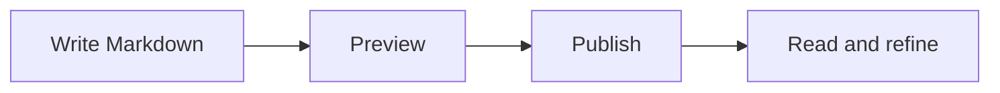
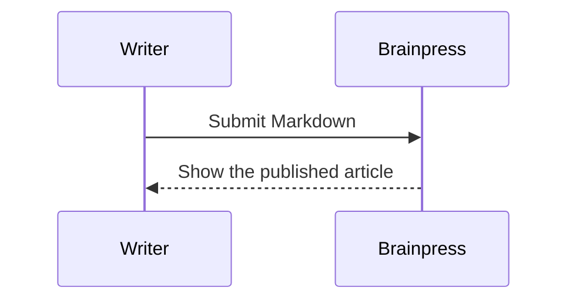

This post demonstrates the extended Markdown renderer in Brainpress. The editor preview and the published article use the same rules. Your original Markdown stays unchanged in the database.

## Mermaid flowchart



## LaTeX mathematics

An inline equation: $E = mc^2$. Subscripts and superscripts stay intact: $x_i^2 + y_i^2 = r^2$.

A display equation:

$$
\int_0^1 x^2\,dx = \frac{1}{3}
$$

A matrix:

$$
A = \begin{pmatrix}1 & 2 \\ 3 & 4\end{pmatrix}
$$

You can also use parentheses: \(\alpha + \beta = \gamma\).

## Tables

| Feature | Syntax | Status |
| :--- | :---: | ---: |
| Tables | Pipes | Ready |
| Task lists | Checkboxes | Ready |
| Diagrams | Mermaid | Ready |
| Math | LaTeX | Ready |

## Task lists

- [x] Preserve Markdown source
- [x] Preview diagrams and math
- [x] Add light and dark themes
- [ ] Keep improving the experience

## Strikethrough and emphasis

~~An old idea~~ can become a **better idea**. Use *italics*, **bold**, or ***both***.

## Automatic links and footnotes

A plain URL becomes a link: https://commonmark.org/

A footnote keeps supporting details out of the main paragraph.[^note]

[^note]: Footnotes are a Markdown extension, included in this version of Brainpress.

## Code remains literal

The renderer does not interpret equations or diagrams inside ordinary code blocks:

```text
$x_i^2$
$$
\frac{a}{b}
$$
```

Inline code also stays literal: `$x_i^2$`.

## Sequence diagram



## Quotes and lists

> Start with a small working version, then improve it through use.

1. Choose a category.
2. Write a post.
   - Add diagrams when they help.
   - Use equations where they belong.
3. Preview and publish.

---

Switch the appearance using the moon or sun button in the header. Your choice is remembered on this browser. Diagram colors follow the selected theme.

